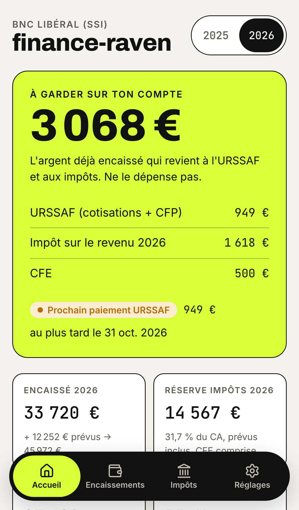
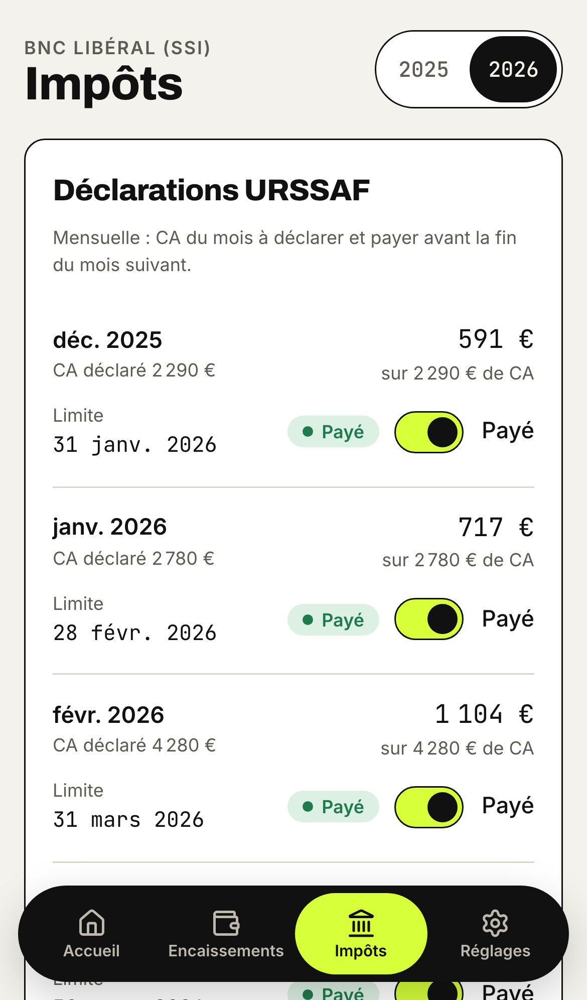
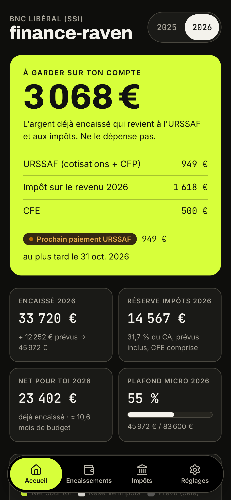
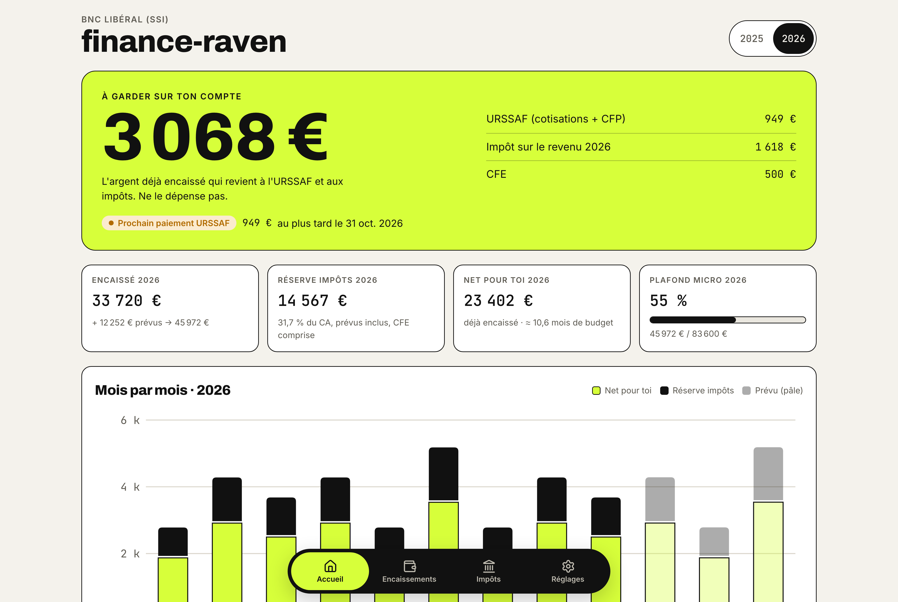

# finance-raven

> Ta caisse de micro-entrepreneur : ce qu'il faut garder pour l'URSSAF et les impôts. Sans compte, sans serveur.

<p align="center">
  
  
  
</p>
<p align="center"></p>

## Ce que ça fait

- **À garder sur ton compte** : l'URSSAF, l'impôt sur le revenu et la CFE déjà dus sur l'argent encaissé.
- **Encaissements** : reçus ou prévus, en EUR, USD, GBP ou CHF, avec le montant réellement crédité en euros.
- **Calendrier URSSAF** : déclaration mensuelle ou trimestrielle, 1re déclaration après la création, échéances et cases « payé ».
- **Impôt sur le revenu** : barème progressif ou versement libératoire, avec l'option la moins chère mise en avant.
- **Seuils** : plafond micro (proratisé l'année de création) et franchise de TVA.
- **À vérifier** : rappels générés à partir de tes données (ACRE, option VFL, plafonds, devises, sauvegarde).
- **Activités** : BNC (SSI ou CIPAV), BIC prestations de services, BIC vente.

## Confidentialité

Pas de serveur, pas de compte, pas de traceur. Les données restent dans le stockage local de ton navigateur.
Partager le lien ne partage que l'app. Exporte une sauvegarde JSON de temps en temps (Réglages → Sauvegarde).

## L'installer sur ton téléphone

- **iPhone (Safari)** : ouvre le lien, touche Partager, puis « Sur l'écran d'accueil ».
- **Android (Chrome)** : menu ⋮, puis « Installer l'application ».

Une fois installée, l'app fonctionne hors ligne.

## Développement

Il faut Node 22+ et pnpm.

```bash
pnpm install
pnpm dev            # http://localhost:5173
pnpm test           # tests unitaires et de composants (Vitest)
pnpm e2e            # test Playwright au format mobile
pnpm storybook      # galerie de composants
pnpm build          # build de production dans dist/
pnpm screenshots    # régénère les captures du README
```

## Organisation du code

- `src/domain/` : les calculs fiscaux en TypeScript pur, entièrement testés. Les taux annuels sont dans `src/domain/rules/rules.constants.ts`.
- `src/store/` : un store Zustand enregistré dans `localStorage`, avec un schéma versionné.
- `src/components/` : les composants d'interface partagés, chacun dans son dossier avec un test et une story.
- `src/features/` : les écrans (accueil, encaissements, impôts, réglages, configuration).

Stack : Vite, React, TypeScript, Zustand, zod, vite-plugin-pwa, CSS Modules, Vitest, Storybook, Playwright.

## Avertissement

Ce sont des estimations indicatives, pas un conseil fiscal. Les taux 2026 viennent de sources publiques. Vérifie-les sur
[urssaf.fr](https://www.autoentrepreneur.urssaf.fr) et [impots.gouv.fr](https://www.impots.gouv.fr).
Quand ils changent, mets à jour `rules.constants.ts` et les tests.

## Licence

[MIT](LICENSE)
